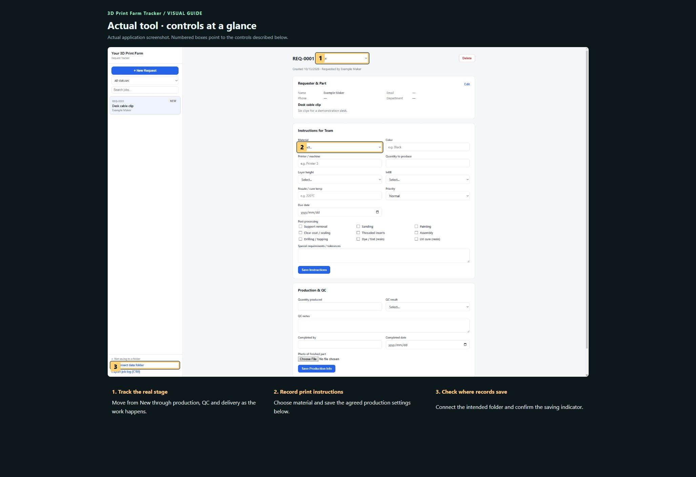
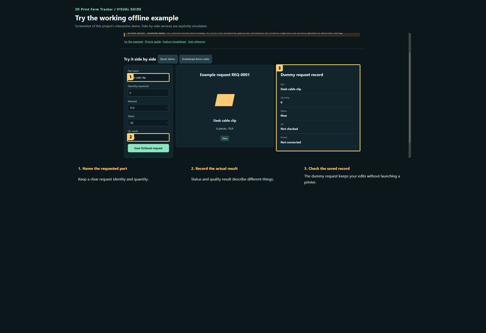

# 3D Print Farm Tracker

Track a print request from intake through production, quality checks and delivery. This browser tool records who asked for a part, the agreed printing instructions and the result, and can generate a traceability report. It does not slice models or launch printers.

**Private preview · not published.**

[Open the visual manual](docs/USER-MANUAL.md) · [Download the self-contained demo](demo.html) · [Release notes](CHANGELOG.md)

Download `demo.html` using GitHub’s Download raw file control, then open it in your browser. GitHub displays HTML source; it does not run the demo on this page. The demo is an offline simulation with fictional data and makes no network requests.

## See it

### Actual tool · controls at a glance

Actual application screenshot. Numbered boxes point to the controls described below. 

1. **Track the real stage.** Move from New through production, QC and delivery as the work happens.
2. **Record print instructions.** Choose material and save the agreed production settings below.
3. **Check where records save.** Connect the intended folder and confirm the saving indicator.

### Try the working offline example

Screenshot of this project’s interactive demo. Side-by-side services are explicitly simulated.

1. **Name the requested part.** Keep a clear request identity and quantity.
2. **Record the actual result.** Status and quality result describe different things.
3. **Check the saved record.** The dummy request keeps your edits without launching a printer.

## What this tool does

| Feature | What it lets you do | Where |
| --- | --- | --- |
| Intake | Requester, part, quantity, date, notes and an optional pasted request email. | Request lifecycle |
| Team instructions | Material, colour, machine, layer height, infill, temperature, priority and finishing requirements. | Request lifecycle |
| Status | New, Instructions Ready, Printing, QC, Completed, Delivered and On Hold. | Request lifecycle |
| Production and QC | Produced quantity, pass/rework/reprint result, notes, operator/date and a finished-part photo. | Request lifecycle |
| Reports | Generate a traceability report for print/PDF and export a CSV job log. | Request lifecycle |
| Folder storage | Connect a data folder when browser support and permission allow it. | Request lifecycle |

## A first useful workflow

### Record a request

1. Choose + New Request. Enter the requester and part details, quantity and due date. Pasting an email keeps it as reference; fill the structured fields yourself.
2. Choose Save Request and note the REQ identifier. Use that identifier in team communications so similarly named parts are not confused.
3. Complete Instructions for Team, including machine, material, layer height and any tolerances/finishing. Save Instructions before changing status.

## Saving and outputs

Browser storage and an explicitly connected folder are distinct. Recheck the saving indicator when reopening the tool; browser permissions may need renewal. CSV is a summary and should not be assumed to contain every photo or detailed field.

## Running the actual tool

Open external-sources/StandaloneTools/3D_Print_Farm_Tracker.html.

The demo has no prerequisites; the real tool may need the services described in the manual and retained source notes.

## Current boundaries

The screenshot contains a fictional request. No real requester details were copied. This tracker is independent of Parts Bench and does not imply automatic printer communication.

## Licence and sharing

MIT applies to original project contributions. Bundled/upstream software and assets retain their own terms; see [third-party notes](THIRD-PARTY.md). Keep this repository private until its own [release checklist](RELEASE-CHECKLIST.md) is complete and the owner authorises publication.
